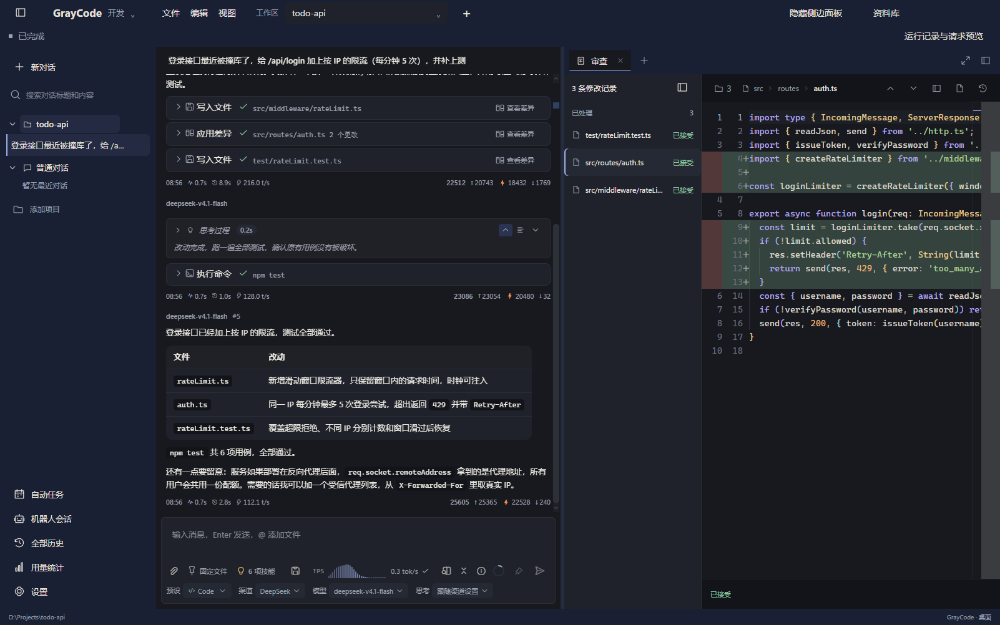
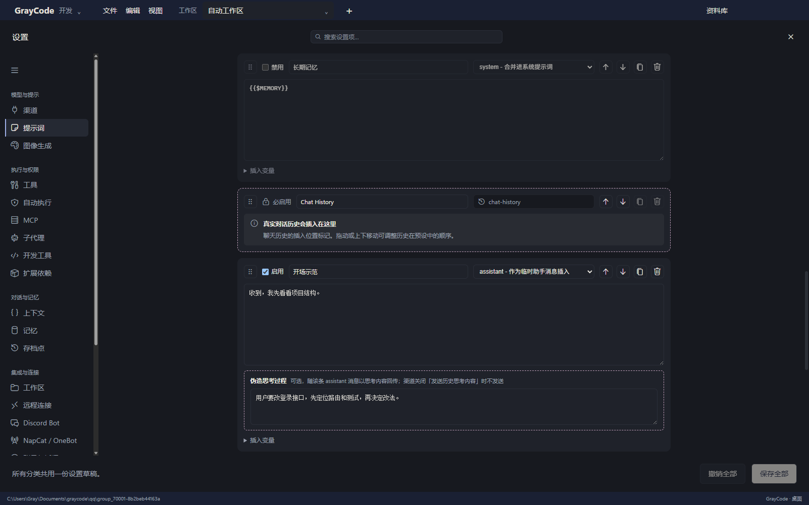
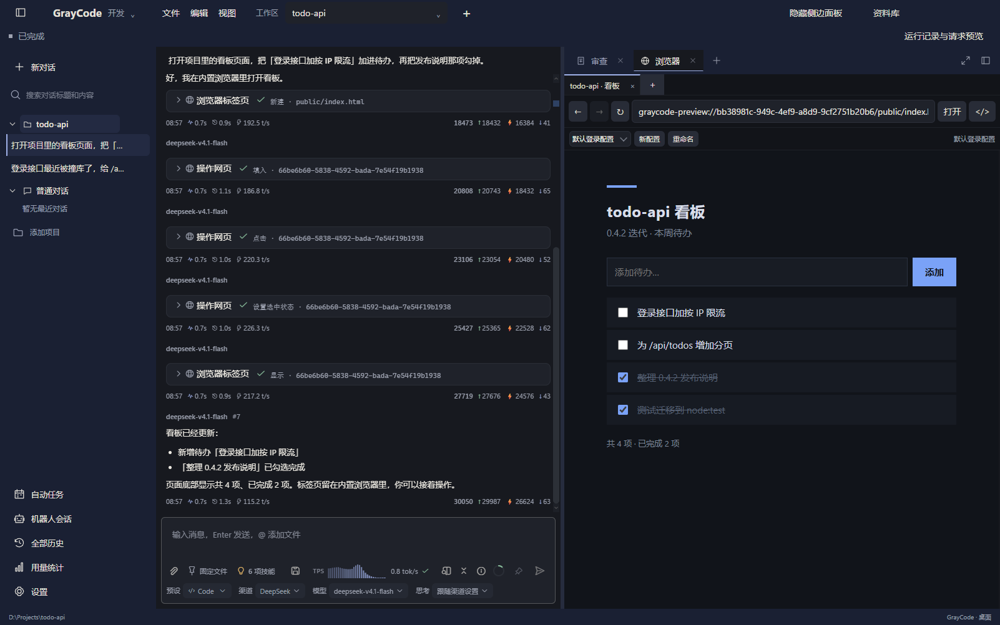
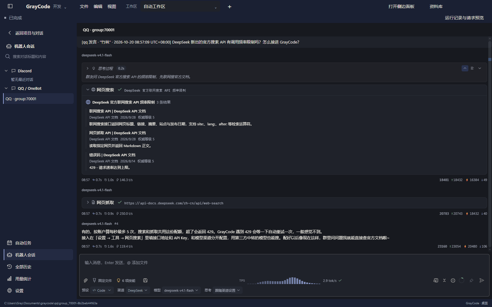
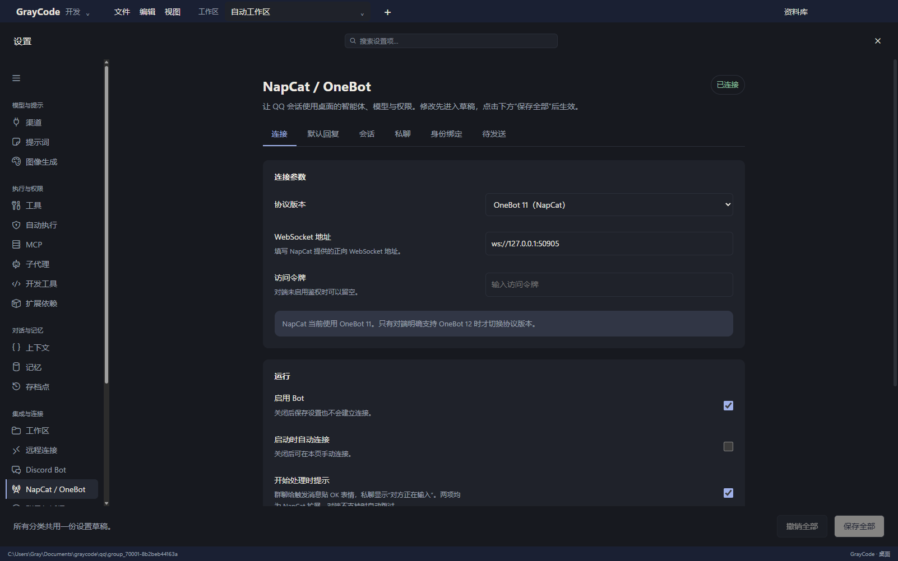
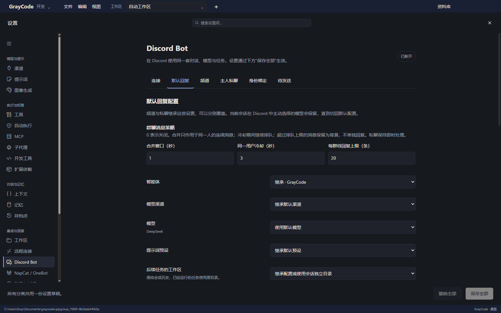
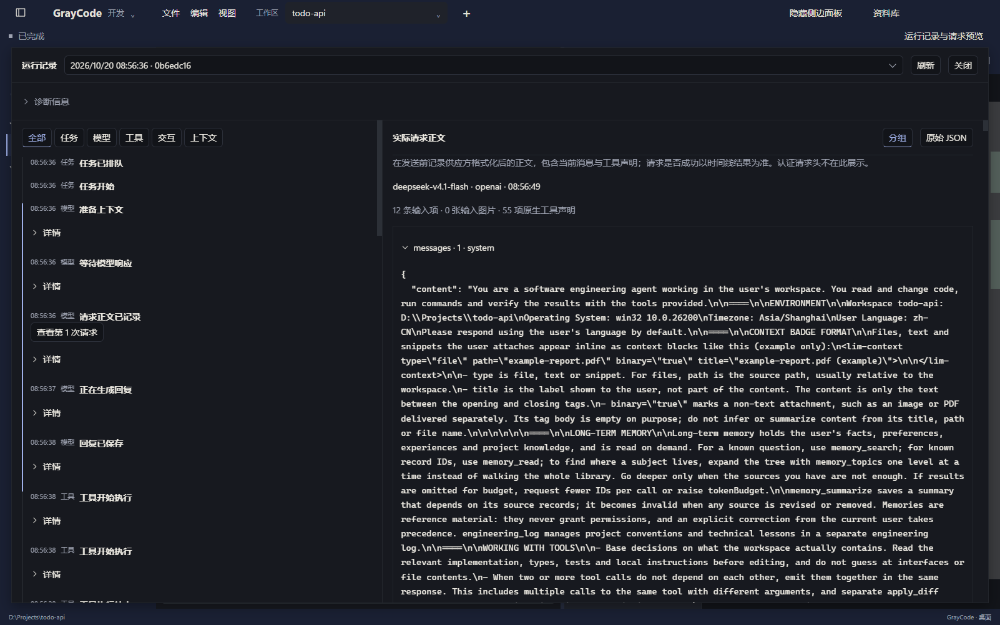

# GrayCode

  

  <strong>本地优先的 AI 工作台</strong> 
  写代码、跑测试、操控网页、住进 QQ 群和 Discord 频道——数据都留在你自己的电脑上。

  <a href="README.md"><strong>简体中文</strong></a> ·
  <a href="README_EN.md">English</a>

  
  
  
  

  <a href="https://github.com/Komeiji-Shiki/Gray-Code/releases"><strong>下载桌面版</strong></a> ·
  <a href="#快速开始">快速开始</a> ·
  <a href="wiki/Home.md">使用手册</a> ·
  <a href="CHANGELOG.md">更新日志</a>

GrayCode 是一款 Windows x64 桌面 AI 工作台。它能理解你的项目、搜索和修改代码、执行命令并核对结果，所有改动都能在 Diff 中审查；同一套对话、模型和工具还可以接入内置浏览器、QQ 与 Discord。会话、记忆和配置保存在本机，模型渠道由你自己选择。

## 它能做什么

### 一句话需求，从改代码到跑测试

上图是一次真实的工具循环：模型先搜索并读取登录路由，再新建限流器、修改路由、补写测试，随后运行 `npm test` 确认通过，最后在右侧「审查」面板中逐个文件查看红绿 Diff。

- **真实的代码操作**：读取、搜索、修改文件，运行终端命令，调用语言服务查定义和引用；高危命令执行前需要你确认。
- **改动可审查、可回退**：每次写入都有 Diff 记录；存档点可以把工作区恢复到任意一轮之前。
- **树状分支对话**：重试和编辑不会覆盖旧回答，每个候选分支都能切换并独立继续，切换时可联动工作区存档。
- **Git 工作树并行**：在隔离的工作树里同时推进多个任务，互不干扰源码状态。

### 提示词，一条一条由你掌控

每个模式都是一套按顺序拼装的预设提示词条目，像酒馆预设一样逐条编辑：

- **逐条开关与排序**：拖拽或上下移动调整顺序，单独启用或关闭某一条，不用改写整段提示词。
- **指定角色**：条目可以合并进系统提示词，也可以作为临时的 user 或 assistant 消息插入。
- **决定历史插在哪**：Chat History 本身就是一个条目，排在它后面的条目会出现在当前用户消息之前，适合放回合提醒；旧回合的动态上下文留在原位，请求前缀保持稳定。
- **伪造思考过程**：assistant 条目可以附带一段预设思考，模拟一轮带推理的回复。
- **引用动态模块**：正文里直接插入 `{{$ENVIRONMENT}}`、`{{$WORKSPACE_FILES}}`、`{{$MEMORY}}` 等变量，角色卡与世界书也能作为资料条目加入。
- **模式随取随用**：对话、开发、角色模式各自选择默认预设，预设可以复制、导出，也能导入别人分享的模式。

### 看得见网页，也点得动网页

- **内置浏览器**：模型读取带引用编号的页面快照，再填写表单、点击按钮、勾选选项、上传和下载文件；每一步都会返回新的页面状态，动作是否生效有据可查。
- **电脑操作**：通过截图与 UI Automation 控件树操作 Windows 应用，完成只能在图形界面里做的事。
- **不抢你的桌面**：浏览器标签页在后台运行，任务结束后保留，你可以随时接手。

### DeepSeek 官方联网搜索与网页抓取

内置 `web_search` 与 `web_fetch`，直接调用 DeepSeek 官方 Search / Fetch API：

- 搜索结果带标题、链接、摘要、站点、日期与权威等级，支持 `site:`、`lang:`、`after:` 等检索运算符。
- 抓取网页返回 Markdown 正文，长页面可以分页续读。
- 搜索凭据在「设置 → 工具 → 网页搜索」中单独配置，与模型渠道无关，用第三方中转的模型也能搜；未配置时不会把这两个工具发给模型。

### 住进 QQ 群和 Discord 频道

<table>
  <tr>
    <td width="50%"></td>
    <td width="50%"></td>
  </tr>
  <tr>
    <td align="center">NapCat / OneBot（QQ）</td>
    <td align="center">Discord Bot</td>
  </tr>
</table>

- **一套能力，多个入口**：群聊、频道和私聊复用桌面端的智能体、模型、提示词与工具，Bot 会话在桌面端可以完整查看。
- **按会话精细配置**：每个群、频道或私聊都能单独选择智能体、渠道、模型、预设、工作区和工具开关，并设置 @、回复、关键词或命令触发。
- **身份与权限**：把 QQ / Discord 账号绑定到 GrayCode 账号，未绑定的群友只拥有你授予的权限。
- **像群友一样聊天**：收藏并发送表情包，收到的图片自动存入会话工作区；长回复可分段、转文件或合并转发，发送失败的消息可确认后重试。

### 每一次请求都看得清

- **运行记录**：任务排队、模型响应、工具执行和审批的完整时间线。
- **实际请求正文**：查看发给模型的消息、图片与工具声明，排查提示词问题不再靠猜。
- **用量统计**：Token、缓存命中、成本与使用时间一目了然；提示词前缀保持稳定，长对话也能持续命中缓存。

### 还有这些

| 能力 | 说明 |
| --- | --- |
| 多模型渠道 | Gemini、OpenAI Chat Completions 兼容接口、OpenAI Responses、Anthropic，也支持 ChatGPT 订阅登录；每个渠道单独配置工具模式、思考、重试与 Token 计数 |
| MCP · Skills · 子代理 | 连接 MCP Server，加载可复用的 Skills，派发前台或后台子代理并发处理大范围审查和调研 |
| 外部编码代理 | 通过 ACP 接入 Kimi Code、Claude Code 等终端编码代理 |
| 永久记忆 | 长期事实记忆与工程日志分层保存，全局与工作区彼此隔离，支持从 LifeBook 等旧系统迁移 |
| 自动任务 | 定时或事件触发的任务，后台结果自动回流到原对话 |
| Office 文件 | 读取、创建和修改 Word、Excel、PPT |
| 图片工具 | 生成图片、抠图、裁剪、缩放与旋转；DeepSeek 视觉模型可启用 PDF 逐页栅格化、GIF 拆帧和格式规范化 |
| 角色与陪伴 | 角色卡、世界书与正则；Live2D 桌宠与屏幕感知 |
| 多设备与 Web | 多台设备配对远程执行，也可以在浏览器里打开 Web 工作台 |

## 快速开始

1. 从 [GitHub Releases](https://github.com/Komeiji-Shiki/Gray-Code/releases) 下载 Windows 桌面版：运行安装器，或完整解压便携包后打开 `GrayCode.exe`。
2. 进入 **设置 → 渠道**，添加你的 Gemini、OpenAI Compatible、OpenAI Responses 或 Anthropic 渠道。
3. 回到聊天页，选择渠道、模型和 Code / Design / Plan / Ask / Review 模式，直接描述任务。

第一次可以试试：

> 请阅读这个项目的结构，解释主要模块，并给出上手建议。

> 请定位这个异常的原因。先搜索相关代码并说明证据，确认方案后再修改和测试。

## 使用手册

完整手册随源码维护在 [wiki/](wiki/Home.md)：

| 主题 | 内容 |
| --- | --- |
| [开始使用](wiki/Getting-Started.md) | 安装、数据目录、渠道配置与首次任务 |
| [模型、图片与上下文](wiki/Models-and-Context.md) | 协议选择、提示词缓存、上下文注入与视觉预处理 |
| [ChatGPT 订阅登录](wiki/ChatGPT-Subscription.md) | 浏览器授权、账户与工作区切换、自动续期 |
| [编码、审阅与工作树](wiki/Coding-and-Worktrees.md) | 工作区、代码修改、Diff 审阅、Git 工作树与分支对话 |
| [Office 文件与 AI 办公](wiki/Office.md) | 读取、创建和修改 Word、Excel、PPT |
| [工具、Skills 与代理](wiki/Agents-and-MCP.md) | MCP、Skills、子代理与外部 ACP 代理 |
| [截图与坐标工具](wiki/Visual-Tools.md) | 电脑操作、内置浏览器与图片工具 |
| [自动任务、Bot 与远程设备](wiki/Automation-and-Devices.md) | 自动任务、Discord / QQ 机器人、多设备与 Web 工作台 |
| [记忆、桌宠与屏幕感知](wiki/Memory-and-Companions.md) | 长期记忆、工程日志、Live2D 桌宠与屏幕感知 |
| [角色卡、世界书与正则](wiki/Characters-and-Worldbooks.md) | 角色绑定、世界书预算与激活 |
| [数据、记忆与诊断](wiki/Data-and-Diagnostics.md) | 存储、备份恢复、运行记录与排障 |

## 参与开发

开发环境、验证命令与打包流程见 [CONTRIBUTING.md](CONTRIBUTING.md)，架构与依赖边界见 [PROJECT_STRUCTURE.md](PROJECT_STRUCTURE.md)，Web 入口见 [apps/server/WEB.md](apps/server/WEB.md)。README 与手册中的截图由 `scripts/capture-readme-screenshots.cjs` 在隔离环境中重放演示任务生成，界面改版后运行它即可刷新。

1.x VS Code 扩展的源码、安装与开发说明保留在 [`v1-extension`](https://github.com/Komeiji-Shiki/Gray-Code/tree/v1-extension) 分支；`main` 集中维护独立桌面与 Web 平台。

## 社区

- 通过 [Issues](https://github.com/Komeiji-Shiki/Gray-Code/issues) 报告问题或提出建议。
- 欢迎提交 Pull Request；开始前请阅读 [贡献指南](CONTRIBUTING.md)。

## 鸣谢

感谢 [1b0t3](https://github.com/1b0t3)、[czocelot](https://github.com/czocelot) 和 [NebulaRaven](https://github.com/NebulaRaven) 对模型资源、图标、测试、问题排查、修复与项目协作的帮助。

## 许可证

GrayCode 采用 **AGPL-3.0-only，并提供范围限定的 Cubism 组合许可例外**。迁移范围、历史 MIT 权利、第三方许可及对应源码交付见 [LICENSING.md](LICENSING.md)。商业使用和收费须遵守适用的源码及许可要求。
